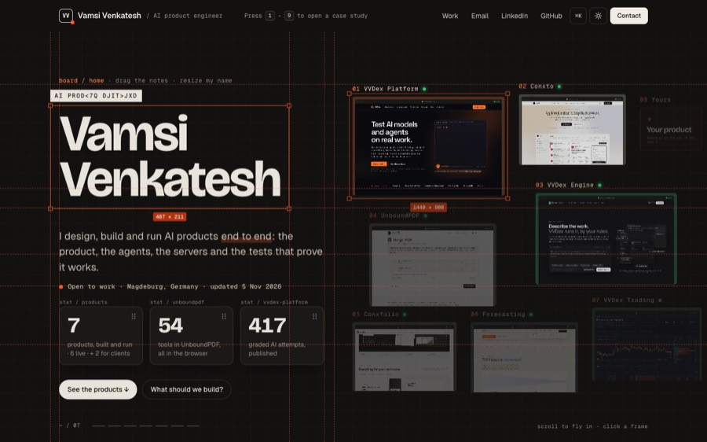

# Portfolio designs

Fifteen ways to present the same work: my live portfolio site, the one before it, a full multi-page site, an earlier board, and eleven interactive experiments in physics, light, sound and 3D. Every one is plain HTML, CSS and JavaScript (plus Three.js or raw WebGL where the design needs it), with no build step.

**Open them live:** https://vamsi-venkatesh.github.io/portfolio-designs/



## The designs

| Folder | Design | Idea | Built with | Live |
| --- | --- | --- | --- | --- |
| `board` | The Board | **My live site since 5 Nov 2026.** All seven products play live on one board; scroll is one camera flying into each | DOM camera, video loops | [open](https://vamsi-venkatesh.github.io/portfolio-designs/board/) |
| `red-dot` | Red Dot | My live site until 5 Nov 2026. A red dot is the mark, the cursor and the door into every product | GSAP, ScrollTrigger, Canvas | [open](https://vamsi-venkatesh.github.io/portfolio-designs/red-dot/) |
| `inside-the-dot` | Inside the Dot | A full 16-page site: home, a case study per product, about, CV, contact | Three.js, WebGL | [open](https://vamsi-venkatesh.github.io/portfolio-designs/inside-the-dot/) |
| `board-v2` | The Board, v2 | An earlier version of the board: live product frames on a board; scroll is one camera flying into each product | DOM camera, video loops | [open](https://vamsi-venkatesh.github.io/portfolio-designs/board-v2/) |
| `01-scale` | Scale | From a blinking cursor out to the galaxies, in one unbroken zoom | Three.js, WebGL | [open](https://vamsi-venkatesh.github.io/portfolio-designs/01-scale/) |
| `02-garden` | Garden | Every click plants an idea that grows in seconds | Canvas 2D | [open](https://vamsi-venkatesh.github.io/portfolio-designs/02-garden/) |
| `03-toybox` | Toybox | The page is a toy: grab, throw, stack, knock it over | Custom physics, Canvas 2D | [open](https://vamsi-venkatesh.github.io/portfolio-designs/03-toybox/) |
| `04-water` | Water | Sunlight through a shallow pool; touch the water | WebGL2 | [open](https://vamsi-venkatesh.github.io/portfolio-designs/04-water/) |
| `05-hundred` | A hundred versions | The page redesigns itself every few seconds through 34 art directions | FLIP morphs, CSS | [open](https://vamsi-venkatesh.github.io/portfolio-designs/05-hundred/) |
| `06-sky` | Night sky | The work is eight constellations; draw your own | WebGL2, Canvas 2D | [open](https://vamsi-venkatesh.github.io/portfolio-designs/06-sky/) |
| `07-instrument` | Instrument | Every line is a string; brush across the page and it plays in key | Web Audio | [open](https://vamsi-venkatesh.github.io/portfolio-designs/07-instrument/) |
| `08-prism` | Prism | Steer a rainbow across the work | WebGL | [open](https://vamsi-venkatesh.github.io/portfolio-designs/08-prism/) |
| `09-window` | The Window | The screen becomes glass onto a sunlit room; with head tracking it moves like a real window | Three.js, off-axis projection, MediaPipe | [open](https://vamsi-venkatesh.github.io/portfolio-designs/09-window/) |
| `10-for-you` | Made for you | Say who you are and the site becomes a world built for you | Three.js, WebGL | [open](https://vamsi-venkatesh.github.io/portfolio-designs/10-for-you/) |
| `11-light` | Hold it to the light | Sunlight through a pane of glass writes each of the nine products on the wall; move the cursor and the sun turns | Three.js, WebGL | [open](https://vamsi-venkatesh.github.io/portfolio-designs/11-light/) |

## Download one

- **One design:** go to [Releases](https://github.com/vamsi-venkatesh/portfolio-designs/releases/latest) and download its `.zip`.
- **All of them:** Code → Download ZIP.

Scale, The Window, Made for you and Hold it to the light load Three.js and MediaPipe from the shared `vendor/` folder, so their zips include it. Run any design with a static server:

```bash
npx serve .
```

## Reuse a design

The code is yours to use under the MIT licence. My name, my products, their screenshots and the facts about them are not covered by it: replace them with your own before you publish. The text is in each design's HTML, or in a content file next to it where there is one (`content.js`, `content.json`, `content.mjs`).

## Notes

- Some designs ask for permission: The Window can use the camera for head tracking (it runs in the browser; nothing is uploaded), and Instrument and Toybox play sound after you press a button.
- The heavier designs (Scale, Made for you, Hold it to the light) are best on a desktop with a recent browser.

By [Vamsi Venkatesh](https://vamsivenkatesh.com).
